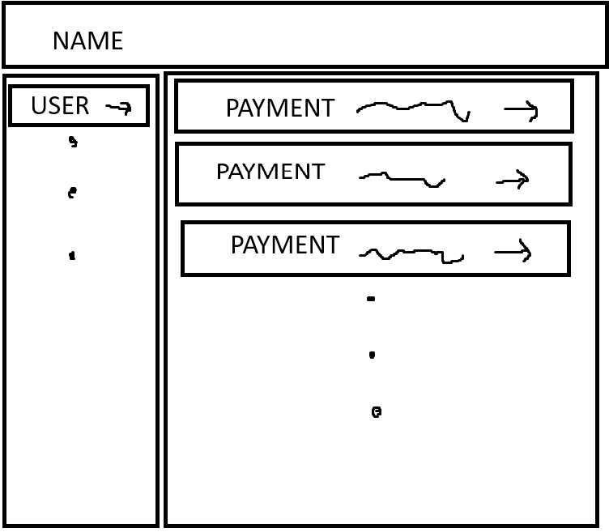

# Splitwise Demo

**Interview demo: Splitwise-style expense tracker** in **React + TypeScript** — groups, members, payments, and balances in the browser.

[](https://github.com/danielnachumdev/splitwise-demo/actions/workflows/ci.yml)

Built for a live coding interview to show rapid UI and service layering. It is **not** production-ready (LocalStorage only, hardcoded demo user, incomplete balance math, no tests).



## Why this demo?

- **Groups & members** — create groups, add people, open a group detail view
- **Payments** — record who paid, how much, and who shares the cost
- **Balances (partial)** — balance service exists; full recalculation / debt breakdown are still stubs
- **Swappable storage** — `Database<T>` interface with a LocalStorage implementation (easy to replace later)
- **Component conventions** — folder-per-component + CSS when needed; see [`COMPONENT_DESIGN_GUIDE.md`](COMPONENT_DESIGN_GUIDE.md)

## Quick start

**Node.js 18+** and npm:

```bash
git clone https://github.com/danielnachumdev/splitwise-demo.git
cd splitwise-demo
npm install
npm run dev
```

Open [http://localhost:5173](http://localhost:5173). There is no login — the UI uses a hardcoded demo user id (`demo-user-123`). Data lives in the browser’s LocalStorage for this origin.

| Script | What it does |
|--------|----------------|
| `npm run dev` | Vite dev server (HMR) on `:5173` |
| `npm run build` | `tsc -b` + production bundle → `dist/` |
| `npm run preview` | Serve the production build locally |
| `npm run lint` | ESLint |

## Stack

- **React 19** + **TypeScript** + **Vite**
- **Material UI (MUI) v7** + per-component CSS
- **React Router DOM v7**
- **LocalStorage** via `src/database/` (no backend)

`tailwindcss` appears in `package.json` but is not wired into the app; prefer MUI + component CSS unless you intentionally adopt Tailwind.

## Limitations (intentional)

- Storage is per-browser LocalStorage only
- Auth is a hardcoded demo user — no real accounts
- No automated tests
- Some balance APIs throw `Not implemented yet`
- CRUD and UI patterns are uneven (interview pace)

A longer improvement backlog used to live in this README; keep product vision light here and put implementation notes in [`AGENTS.md`](AGENTS.md).

## For developers / agents

Layout, services, domain gotchas, and PR/CI labels: **[AGENTS.md](AGENTS.md)**. Component folder/CSS rules: **[COMPONENT_DESIGN_GUIDE.md](COMPONENT_DESIGN_GUIDE.md)**.

## License

No `LICENSE` file is checked in yet. Treat the repo as source-available for demo/learning unless a license is added.
